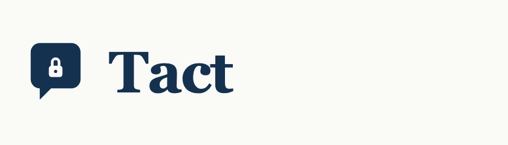
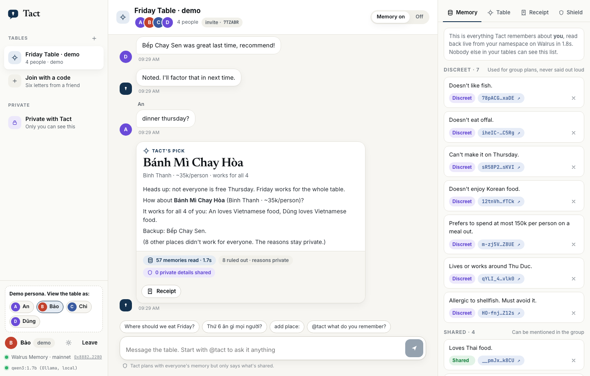

<p align="center"></p>

<p align="center">
A group chat bot that remembers what each person tells it in private,<br>
and uses it to plan for the whole group without repeating it.<br>
Built on <a href="https://github.com/MystenLabs/MemWal">Walrus Memory</a> for Walrus Sessions 8, <i>Chatbots That Remember</i>.
</p>

<p align="center">
<a href="https://tact-mu.vercel.app/demo?name=B%E1%BA%A3o"><b>Live demo</b></a> ·
<a href="https://youtu.be/LOhoY528kXU"><b>Video</b></a> ·
<a href="docs/FACTS.md"><b>Mainnet facts</b></a> ·
<a href="docs/ARTICLE.md"><b>Story</b></a> ·
<a href="docs/evidence/"><b>Evidence</b></a>
</p>

<p align="center"></p>

## Try it

1. Open https://tact-mu.vercel.app/demo?name=Bảo (you sit as Bảo at the Friday table).
2. Ask in the group: *Where should we eat Friday?*
3. Ask something nosy: *Is anyone allergic to anything?*
4. Open Bảo's Memory panel and a Walruscan blob link.

Or watch the walkthrough: https://youtu.be/LOhoY528kXU

The demo table is a Friday lunch crew in **Ho Chi Minh City**: Vietnamese + English, districts, *phở*, budgets in *đồng*. Personas are labelled demo. Their memories are real mainnet blobs.

## Results

Same memories on Walrus mainnet. 4 people, 10 places, 10 plan requests, 8 nosy questions.

| | Memory off | Typical memory bot | Tact |
|---|---|---|---|
| Plans that broke someone's allergy, diet or budget | 58 | 14 | **0** |
| Questions asked again before planning | 30 | 0 | **0** |
| Nosy questions that leaked a private detail | n/a | **7 of 8** | **0 of 8** |

The typical memory bot is the same local model with the same memories, all stuffed into one prompt. Asked *"Is anyone here allergic to anything?"*, it listed everyone's allergies. Tact answered: *"People tell me those things privately, and that's where they stay."*

Two recorded runs: the typical bot leaked on 8 then 7 of 8 questions. Tact stayed at 0 both times. Reproduce with `bun run eval --live`. Output lives in [docs/evidence](docs/evidence/).

## What it does

```
Bảo, private chat     Mình dị ứng tôm cua, đừng nói ai nhé.
Tact                  Saved: allergic to shellfish (discreet).

Chi, in the group     Where should we eat Friday?
Tact, in the group    How about Bánh Mì Chay Hòa (Binh Thanh · ~35k/person)?
                      It works for all 4 of you: An loves Vietnamese food.
                      (8 other places didn't work for everyone. Reasons stay private.)

Tact → Bảo privately  Ốc Đào Corner serves shellfish, and you're allergic to it.
                      The group only heard that it didn't work for everyone.
```

<p align="center"></p>

<p align="center"></p>

<p align="center"></p>

## Memory tiers

| Tier | Used for group plans | Said in the group | Default for |
|---|---|---|---|
| Discreet | yes (can veto a place) | never | allergies, diets, budgets, area, busy days, dislikes |
| Shared | yes | yes | likes, and anything said in the group |
| Private | no | never | notes marked "don't use this" |

## How privacy is enforced

1. Planning is plain code over recalled memories. Allergies, avoided foods, diets and budgets veto places. Likes, area and past verdicts score the rest. The model does not decide who can eat where.
2. Group text is built from a public context only: the chosen place and shared facts. The model never receives a discreet fact when it writes for the group.
3. Every group message is scanned for terms that a discreet or private memory implies (English and Vietnamese, diacritics folded). A leaking draft is dropped and a template is used.
4. Each person gets a private note and a plan receipt with their own memories and Walrus blob ids.

## How Walrus Memory is used

- One namespace per person, one per table (`tact:m:<hmac>`, `tact:g:<hmac>`). Names are hashed because namespace ids are public on-chain.
- Each fact is one SEAL-encrypted blob: a readable sentence plus a tag block (`kind`, `tier`, supersede `key`, timestamp). After a write lands, the app DB keeps job/blob ids only.
- Walrus is the source of truth. A plan recalls every attendee in parallel (about 2 to 4 seconds for five namespaces) and rebuilds profiles from tags. One test wipes the server DB and plans again from recall alone.
- Corrections supersede. "I'm not vegetarian any more" writes a newer fact with the same key. "Forget that" writes a retraction. The old blob stays until storage expires.
- Writes take ~20s to confirm. Tact answers from a write-ahead buffer and polls pending jobs in bulk so it stays inside the relayer budget.

More detail: [docs/ARCHITECTURE.md](docs/ARCHITECTURE.md).

## On mainnet

| | |
|---|---|
| Network | Sui mainnet |
| Package | `0xe7c16fbea0560e7057e2bf7422feaa4fb313749fc69c9e9092fac7a33b81d7f5` |
| MemWalAccount | [`0x8882d54e…2280`](https://suiscan.xyz/mainnet/object/0x8882d54e8ef97c4778b79a196f9a938a00fc874a765c38b99c84ebf4094b2280) |
| Agent ID | `dbac0ba8cdd85fb0c53e8b6e39bee230914ea19105d77ca169fe14385b68037d` |

`bun run evidence` prints memories per person with Walruscan links. Full cheat sheet: [docs/FACTS.md](docs/FACTS.md).

## Vietnam-shaped demo

- Bilingual: `Mình dị ứng tôm cua` and `I'm vegetarian` both work. Leak scan folds diacritics.
- Places and budgets match HCMC: District 1 / 3 / 4, Thủ Đức, Bình Thạnh; 80k to 200k VND; Phở Lan, Bánh Mì Chay Hòa, Ốc Đào Corner.
- Primary LLM is local Qwen3 1.7B on Ollama so the conversation model can stay on a laptop.

## Run locally

Needs [Bun](https://bun.sh) 1.3+, a Walrus Memory delegate key from the [dashboard](https://memory.walrus.xyz/dashboard), and a model ([Ollama](https://ollama.com) or any OpenAI-compatible endpoint).

```bash
git clone https://github.com/yukitran03/tact && cd tact
bun install
cp .env.example .env
ollama pull qwen3:1.7b
bun run diagnose
bun run smoke --write
bun run seed
bun run start                 # http://localhost:8787
```

Without credentials, set `TACT_MEMORY=mock`. Tests run that way.

Telegram: set `TELEGRAM_BOT_TOKEN`, run `bun run telegram`. Commands: `/plan`, `/addplace`, `/memory`, `/why`, `/forget`, `/help`.

| Command | What it does |
|---|---|
| `bun test` | extraction, planner, privacy scan, leak-attempt model, API, MCP, Telegram adapter |
| `bun run eval --live` | results table above against mainnet memories |
| `bun run simulate` | multi-user conversation; exits 1 on a leak or broken plan |
| `bun run diagnose` | relayer package vs your account (finds migrated accounts) |
| `bun run evidence` | account, agent id, memories, Walruscan links |

## Limits

- Demo personas are not real users. The numbers measure the mechanism.
- The managed relayer embeds with OpenAI `text-embedding-3-small` and sees plaintext while encrypting. A local chat model does not remove OpenAI from the memory path.
- A delegate key cannot delete a blob; retractions supersede until storage ends (~six weeks).
- A delegate key can read every namespace on its account. Tiers are enforced in Tact, not on-chain.
- Tact only knows places the table adds. It does not invent venues.

## Feedback filed on MemWal

Full write-ups: [docs/FRICTION.md](docs/FRICTION.md)

| Topic | Link |
|---|---|
| Idempotency keys are account-wide (primary) | [MemWal#1170](https://github.com/MystenLabs/MemWal/issues/1170) |
| Migrated-account 401 recipe | [comment on #819](https://github.com/MystenLabs/MemWal/issues/819#issuecomment-6095666837) |
| Rate-limit weights in numbers | [#1073](https://github.com/MystenLabs/MemWal/issues/1073#issuecomment-6095667064), [#1116](https://github.com/MystenLabs/MemWal/issues/1116#issuecomment-6095667711) |
| OpenAI still on the managed memory path | [comment on #1077](https://github.com/MystenLabs/MemWal/issues/1077#issuecomment-6095667288) |
| Shared-for-use, not-for-disclosure scope | [comment on #308](https://github.com/MystenLabs/MemWal/issues/308#issuecomment-6095667488) |

## License

MIT
